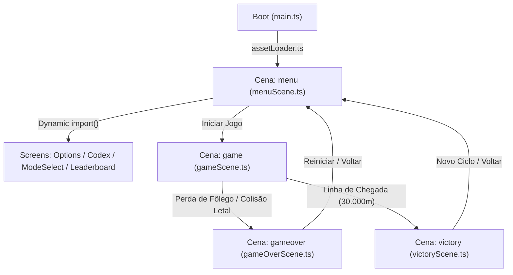
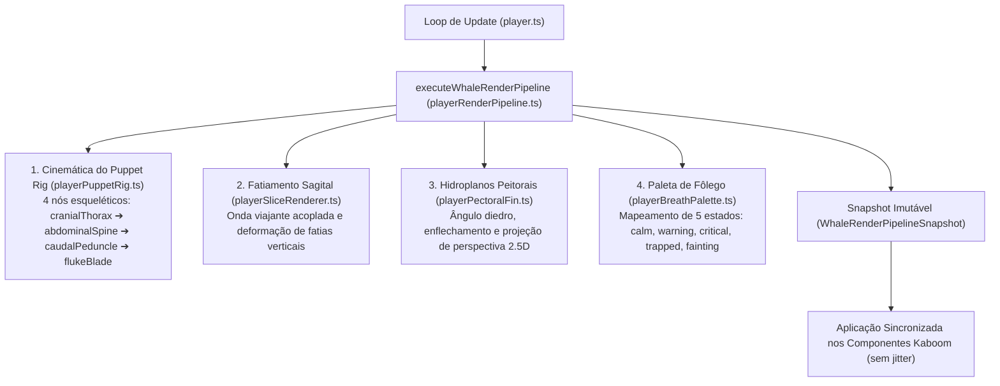
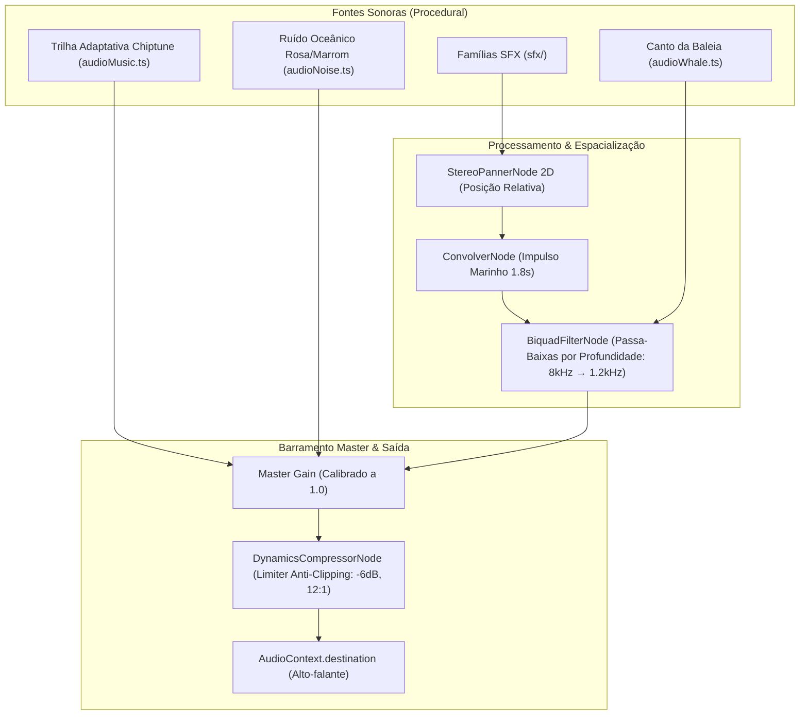
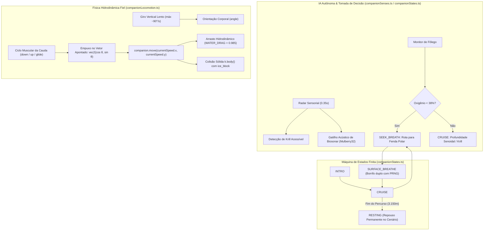
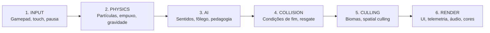

# 🏗️ Arquitetura do Sistema - Micro Splash

O **Micro Splash** foi construído sobre uma arquitetura modular orientada a eventos e componentes, utilizando a engine **Kaboom.js** combinada a **TypeScript**, **Web Audio API** para síntese procedural em tempo real e empacotamento ultrarrápido via **Vite**.

---

## 🗂️ Estrutura de Diretórios e Módulos

```
micro-splash/
├── data/
│   ├── facts.json                  # Acervo pedagógico de curiosidades marinhas indexadas por bioma
│   ├── quiz.json                   # Banco de perguntas e respostas para o desafio educacional
│   └── level_layout.json           # Definição espacial de biomas, densidades e marcos náuticos
├── docs/
│   ├── ARCHITECTURE.md             # Este documento (visão técnica e estrutural)
│   ├── GDD.md                      # Game Design Document completo
│   ├── OCEAN_FACTS.md              # Fundamentação científica e artigos revisados por pares
│   └── ROADMAP.md                  # Roteiro de fases e status de entrega
├── public/
│   ├── fonts/                      # Fontes locais otimizadas (WOFF2 prioritário com fallback TTF)
│   ├── sprites/                    # Texturas e spritesheets (incluindo fauna_manifest.json)
│   ├── offline.html                # Tela de contingência offline PWA estilizada
│   └── sw.js                       # Service Worker com cache LRU versionado dinamicamente
├── scripts/                        # Utilitários de build, validação e geradores em Node/ESM
├── src/
│   ├── config.ts                   # Parâmetros físicos, biomas, sementes, tags e dimensões
│   ├── main.ts                     # Ponto de entrada enxuto e boot do Kaboom.js
│   ├── scenes/                     # Módulos isolados de cenas Kaboom
│   │   ├── assetLoader.ts          # Pré-carregamento determinístico de atlas e recursos
│   │   ├── menuScene.ts            # Cena de menu com code-splitting dinâmico
│   │   ├── gameScene.ts            # Orquestrador do loop de gameplay de 30.000m
│   │   ├── gameOverScene.ts        # Cena dramática de resgate ou fim de jogo
│   │   └── victoryScene.ts         # Cena de celebração com ritual do salto e eco-score
│   ├── entities/                   # Atores e objetos interativos do jogo
│   │   ├── player.ts               # Fachada da Jubarte (orquestração e ciclo de vida)
│   │   ├── player/                 # Módulos especializados de biomecânica e renderização
│   │   │   ├── playerRenderPipeline.ts # Coordenador puro e determinístico de renderização
│   │   │   ├── playerPuppetRig.ts      # Cinemática direta de 4 nós e flukes caudais
│   │   │   ├── playerSliceRenderer.ts  # Fatiamento sagital vertical e onda viajante
│   │   │   ├── playerPectoralFin.ts    # Hidroplanos peitorais com diedro e perspectiva 2.5D
│   │   │   ├── playerBreathPalette.ts  # Colorimetria centralizada dos estados de fôlego
│   │   │   ├── playerAnimation.ts      # Interpolador harmônico de spritesheet de 16 quadros
│   │   │   ├── playerDrift.ts          # Simulação de balanço de maré e deriva orbital
│   │   │   ├── playerCaustics.ts       # Iluminação e cáusticos ventrais dinâmicos
│   │   │   ├── playerCollision.ts      # Gerenciamento de redes, armadilhas e salvamento
│   │   │   └── playerParticles.ts      # Spawners de vórtices peitorais e bolhas
│   │   ├── companionWhale.ts       # Fachada da Baleia-Guia NPC (Mãe-Guia Antártica) autônoma
│   │   ├── companion/              # Módulos especializados da IA da Baleia-Guia
│   │   │   ├── companionStateMachine.ts # Orquestrador formal da máquina de estados (FSM)
│   │   │   ├── companionLocomotion.ts   # Propulsão, decaimento e arrasto hidrodinâmico
│   │   │   ├── companionSenses.ts       # Varredura sensorial com acelerador espacial
│   │   │   ├── companionStates.ts       # Fachada retrocompatível de estados e respiração
│   │   │   ├── states/                  # Nós concretos de estado (Intro, Cruise, Seek, etc.)
│   │   │   └── types.ts                 # Contratos de controle, estado e colisão
│   │   ├── boat.ts                 # Traineiras de pesca artesanal e barcos da guarda costeira
│   │   ├── iceberg.ts              # Plataforma de gelo polar com fendas de respiração
│   │   ├── krill.ts                # Cardumes alimentares com atração magnética e física oscilatória
│   │   ├── net.ts                  # Redes de pesca fantasma com mecânica de enredamento e ruptura
│   │   ├── ship.ts                 # Cargueiros industriais móveis com ruído e perigo de colisão
│   │   └── trash.ts                # Lixo plástico camuflado no fundo com revelação por sonar
│   ├── systems/                    # Sistemas de simulação de mundo, áudio e acessibilidade
│   │   ├── accessibilitySystem.ts  # Daltonismo, tipografia, foco e movimento reduzido
│   │   ├── companionTutorialSettings.ts # Configurações, persistência e alternância da Baleia-Guia
│   │   ├── systemRunner.ts         # Despachante orquestrador de fases do game loop
│   │   ├── spatialHashGrid.ts      # Particionamento espacial 2D em células uniformes O(1)
│   │   ├── frameBudgetMonitor.ts   # Auditoria de orçamento de frame time e picos de GC
│   │   ├── audioSystem.ts          # Fachada canônica para o subsistema de áudio
│   │   ├── audio/                  # Arquitetura modular de áudio e síntese Web Audio API
│   │   │   ├── audioEngine.ts      # Master bus, limiter (-6dB), convolver e ciclo de aba
│   │   │   ├── audioMusic.ts       # Motor musical procedural com crossfade entre biomas
│   │   │   ├── audioNoise.ts       # Geradores de ruído marrom/rosa para ambiência
│   │   │   ├── audioWhale.ts       # Canto da baleia em síntese FM acionado por sonar
│   │   │   └── sfx/                # Efeitos sonoros divididos por famílias temáticas
│   │   ├── spatialCullingSystem.ts # Culling frustum com histerese e visibilidade O(1)
│   │   ├── biomeLifecycleManager.ts# Ciclo de vida e desova determinística de entidades
│   │   └── ...
│   ├── ui/                         # Interface do usuário decomposta e modular
│   │   ├── screens/                # Telas completas (optionsScreen, codexScreen, etc.)
│   │   ├── modals/                 # Diálogos modais (quizModal, shareModal, statsModal)
│   │   ├── hud/                    # Componentes do HUD de navegação e oxigênio
│   │   ├── shared/                 # Componentes compartilhados e botões padronizados
│   │   ├── animationUtils.ts       # Tokens UI_TRANSITIONS e transições com easings
│   │   └── keyboardNav.ts          # Pilha LIFO de foco com suporte a focus trap
│   └── utils/                      # Funções puras, persistência e matemática determinística
│       ├── storage.ts              # Persistência desacoplada validada com schemas Zod
│       ├── random.ts               # PRNG determinístico Mulberry32 com semente
│       ├── contrast.ts             # Algoritmo de contraste e luminância WCAG 2.1 AA
│       └── errorReporter.ts        # Barramento unificado de telemetria e erros
```

---

## 🔄 1. Ciclo de Vida e Máquina de Cenas (`src/scenes/`)

O jogo gerencia a navegação entre estados através de cenas modulares do Kaboom.js com suporte a **Code-Splitting assíncrono**:



- **`assetLoader`**: Pré-carrega de forma determinística os atlas de sprites, manifesto de fauna e fontes antes da ativação do menu inicial.
- **`menuScene`**: Tela inicial receptiva com partículas bioluminescentes, recordes persistentes e interface modal bloqueante (`isModalOpen`). Importa telas sob demanda com `await import(...)`.
- **`gameScene`**: Instancia a rota de 30.000m, o jogador via singleton O(1), os sistemas de bioma, áudio, fauna e colisões de acordo com o modo selecionado.
- **`gameOverScene`**: Sequência dramática com tentativa de resgate pela Guarda Marítima na Costa Urbana.
- **`victoryScene`**: Clímax do Salto Majestoso (_Breach_), cálculo do Eco-Score e exibição da Sabedoria Ancestral herdada.

---

## 🐋 2. Entidade Jogador & Pipeline Biomecânica (`src/entities/player/`)

A Baleia-Jubarte utiliza uma arquitetura puramente determinística baseada no coordenador central `playerRenderPipeline.ts`. O loop de física alimenta o coordenador, que calcula a cinemática e devolve um snapshot imutável (`WhaleRenderPipelineSnapshot`):



### Detalhamento das Camadas Biomecânicas

1. **Cinemática Direta do Puppet Rig (`playerPuppetRig.ts`):**
   - Resolve a cadeia de 4 juntas articuladas da jubarte em espaço local.
   - Calcula o ângulo de ataque ótimo da lâmina caudal contra o fluxo hidrodinâmico, gerando empuxo realista tanto na batida descendente quanto ascendente.
2. **Deformação Sagital por Fatiamento Segmentado (`playerSliceRenderer.ts`):**
   - Divide o corpo da baleia em fatias verticais anatômicas interpoladas por uma onda senoidal viajante amortecida.
   - Atenua automaticamente a amplitude da flexão em 75% quando a preferência de movimento reduzido (`isReducedMotion`) está ativa.
3. **Hidroplanos Peitorais Independentes (`playerPectoralFin.ts`):**
   - Simula as longas nadadeiras peitorais brancas da jubarte com variação de ângulo diedro (sustentação/mergulho) e enflechamento hidrodinâmico conforme a velocidade.
   - Camadas organizadas por profundidade z-index para simular perspectiva tridimensional no plano 2D.
4. **Colorimetria Centralizada por Estado de Fôlego (`playerBreathPalette.ts`):**
   - Mapeia as cores de corpo, nadadeiras e pregas em 5 estados biológicos:
     - **Calm** (oxigênio > 50%): tonalidade natural límpida.
     - **Warning** (20% a 50%): transição âmbar de alerta com dessaturação.
     - **Critical** (< 20%): pulso rítmico de urgência e cianose.
     - **Trapped** (emaranhamento): matiz púrpura característico de aprisionamento em redes de pesca.
     - **Fainting** (anóxia/desmaio): tonalidade profunda e fosca.
5. **Spritesheet Harmônico de 16 Quadros (`playerAnimation.ts`):**
   - Ciclos de animação de alta fluidez desenhados à mão, com interpolação contínua proporcional à velocidade de nado e cadência respiratória.
6. **Física de Deriva Orbital e Cáusticos (`playerDrift.ts` & `playerCaustics.ts`):**
   - Aplica balanço oceânico e deriva de maré ao permanecer estática, sincronizada com ondulações de luz cáustica ventral.

---

## 🎵 3. Sistema de Áudio Modular & Masterização 16-Bit (`src/systems/audio/`)

O áudio do jogo é gerado **100% em tempo real** via Web Audio API, sem depender de arquivos de áudio externos, operando em uma arquitetura modular de barramentos com masterização profissional:



- **Masterização e Limiter Anti-Clipping:** Inserção de `DynamicsCompressorNode` (threshold `-6dB`, ratio `12:1`, attack `3ms`, release `250ms`) na saída master. Ganho calibrado para evitar distorção ou bombeamento na presença de múltiplos SFX simultâneos.
- **Rampas de Ganho sem Cliques (De-clicking):** Todos os controles de volume e alternâncias de trilhas utilizam interpolação assintótica `setTargetAtTime` para assegurar transições suaves.
- **Crossfade Chiptune entre Biomas:** Transição harmônica suave de 1.5s a 2.0s via rampa de ganho entre os temas procedurais dos 4 biomas, preservando o andamento fixo de 75 BPM.
- **Espacialização Estéreo 2D (`StereoPannerNode`):** SFX de colisões, krill, redes, gelo, cliques de golfinhos e cargueiros calculam balanço estéreo em `[-1, 1]` baseado na distância horizontal relativa `(sourceX - playerX) / 400`.
- **Acústica Abissal & Reverb Convolutivo:** Resposta de impulso sintética de 1.8s simulando reflexões subaquáticas combinada a filtro passa-baixas modulado pela profundidade (8.000 Hz na lâmina d'água até 1.200 Hz nas fossas).

---

## 🗺️ 4. Geometria dos Biomas e Level Design (`src/config.ts` & `src/systems/`)

A rota de 30.000 metros é particionada em zonas geográficas e comportamentais estritas:

| Faixa (Metros)        | Bioma                         | Tom da Água                | Elementos Chave                                                               |
| :-------------------- | :---------------------------- | :------------------------- | :---------------------------------------------------------------------------- |
| **0m – 5.000m**       | Antártica (Alimentação Polar) | Azul Gélido (`#051c38`)    | Teto de gelo, fendas de respiração, fartura de Krill, silhuetas de orcas.     |
| **5.000m – 12.000m**  | Oceano Aberto (Travessia)     | Azul Escuro (`#0a2850`)    | Jejum total de Krill, correntes, nado de jubartes adultas ao fundo.           |
| **12.000m – 19.000m** | Costa Urbana (Ameaças)        | Verde Urbano (`#0d3c5e`)   | Navios industriais, poluição sonora, lixo camuflado, redes e Guarda Marítima. |
| **19.000m – 25.000m** | Cânions de Ressurgência       | Turquesa (`#0e668b`)       | Jatos d'água ascensionais, fendas estreitas do Boqueirão e nutrientes.        |
| **25.000m – 30.000m** | Santuário de Arraial          | Turquesa Claro (`#1490b8`) | Águas rasas, berçário (mãe e filhote) e evento de Salto Majestoso (29.700m).  |

---

## 🐋 5. Tutorial Mimético & Baleia-Guia Autônoma Modular (`src/entities/companion/`)

A Baleia-Guia (Mãe-Guia Antártica) introduz um modelo de aprendizado mimético (_cultural transmission_ na etologia de cetáceos) nos primeiros 3.200 metros da rota. Ela espelha com precisão a física e as mecânicas vitais do jogador através de uma arquitetura modular decomposta em submódulos focados sob `src/entities/companion/`:

- **`types.ts`**: Contratos canônicos de estado (`CompanionState`), opções com suporte a semente (`CompanionOptions`), controlador (`CompanionWhaleController`) e interface de colisão tipada `CompanionCollidable` com o type guard `isCompanionCollidable`.
- **`companionSenses.ts`**: Radar sensorial (varredura a cada 0.35s), detecção de cardumes de krill e emissão de biosonar 360° com dispersão acústica determinística.
- **`companionLocomotion.ts`**: Física hidrodinâmica, arfagem vertical gradual (máx ~90°/s), propulsão vetorial direcional com rubber-banding e colisão sólida `k.body()` contra calotas de gelo.
- **`companionStates.ts`**: Máquina de estados (FSM: `INTRO`, `CRUISE`, `FEEDING`, `SEEK_BREATH`, `SURFACE_BREATHE`, `RESTING`, `DEPARTED`), ciclo pulmonar de oxigênio e borrifo de vapor determinístico com PRNG Mulberry32.
- **`index.ts` e `companionWhale.ts`**: Fachada unificada retrocompatível e orquestração.



### Características Centrais da Arquitetura da Baleia-Guia

1. **Movimentação Hidrodinâmica Direcional**:
   - Elimina o deslizamento lateral desacoplado.
   - Aplica manobra de arfagem lenta (`GAME_CONFIG.ROTATION_SPEED * 0.75 * dt`), girando o corpo suavemente em direção à profundidade desejada.
   - O empuxo das batidas de cauda (`stroke_down` e `stroke_up`) é direcionado exclusivamente no vetor polar $\begin{pmatrix} \cos\theta \\ \sin\theta \end{pmatrix}$.
   - No planeio (`glide`), a baleia avança por inércia e arrasto aquático sem empuxo adicional.
2. **Colisão Física Sólida com Gelo & Type Safety**:
   - Provida do componente Kaboom `k.body()`, colidindo fisicamente contra blocos estáticos de gelo polar (`ice_block`).
   - Callbacks no sistema de colisões operam sobre o type guard estrito `isCompanionCollidable`, sem type casting forçado.
   - O contato anula o componente de velocidade ascendente e estabiliza a angulação na horizontal.
3. **Mecânicas Ecológicas Espelhadas & Determinismo**:
   - **Consumo Real de Krill**: Detecção por varredura, atração em ângulo de perseguição e destruição da entidade com incremento de fôlego e animação `feed`.
   - **Respiração em Fendas Polares**: Identificação dinâmica de aberturas na banquisa (`isPositionInIceGap`), subida à superfície, emissão de borrifo duplo com som e renovação a 100% do oxigênio. Partículas emitidas através de PRNG determinístico Mulberry32.
   - **Biosonar 360° Funcional**: Pulso acústico que ilumina itens, perigos e recursos via `revealEntitiesInSonarRadius` com intervalos estocásticos reprodutíveis por semente.
4. **Repouso Estacionário Permanente (`RESTING`)**:
   - Ao concluir a travessia antártica (~3.150m), a baleia emite sua canção e transiciona para `RESTING`.
   - Ela desacelera suavemente até parar (`currentSpeed -> 0`), assume a animação `idle_swim` e permanece serena flutuando no cenário polar, garantindo que nunca desapareça abruptamente da visão do jogador (`k.destroy` removido).

---

## 🖥️ 6. Arquitetura de UI, Code-Splitting & Acessibilidade (`src/ui/`)

A camada de interface gráfica é desacoplada da lógica central de simulação:

1. **Reorganização em Subdomínios Semânticos:**
   - `src/ui/screens/`: Telas completas (`optionsScreen`, `codexScreen`, `victoryScreen`, `challengeEndScreen`).
   - `src/ui/modals/`: Caixas de diálogo modais isoladas (`quizModal`, `shareModal`, `statsModal`, `pwaInstallModal`).
   - `src/ui/hud/`: Instrumentação em tempo real (oxigênio, velocímetro, sonar, alertas e minimapa).
   - `src/ui/shared/`: Componentes reutilizáveis com efeitos táteis universais (`attachButtonHoverEffect`).
2. **Code-Splitting Dinâmico:**
   - As telas e modais pesados são carregados sob demanda através de `await import(...)`, permitindo que o chunk principal inicial do jogo seja enxuto (~232 kB gzipped em produção).
3. **Tokens e Transições de Animação (`src/ui/animationUtils.ts`):**
   - Constantes centralizadas `UI_TRANSITIONS` (`MODAL_ENTER_DURATION`, `MODAL_EXIT_DURATION`, `FADE_SCENE_DURATION`, `BUTTON_HOVER_SCALE`, `TOAST_DURATION`).
   - `animateModalExit` com easing cúbico para saída simétrica antes da destruição dos nós Kaboom.
4. **Pilha de Foco Acessível (LIFO) & Focus Trap (`src/ui/keyboardNav.ts`):**
   - Suporte completo a navegação por teclado (Tab, Shift+Tab, setas direcionais, Enter/Espaço para acionamento).
   - Ao abrir um modal, o elemento ativo anterior é preservado no snapshot da pilha e automaticamente restaurado ao fechar.
5. **Auditoria de Contraste WCAG 2.1 AA & Formatação Internacionalizada:**
   - `src/utils/contrast.ts`: Validação de taxa de contraste superior a 4.5:1 para textos regulares e 3.0:1 para badges grandes sobre fundos translúcidos.
   - `src/i18n/i18n.ts`: Formatação numérica, métrica (milhas náuticas e metros) e datas localizada via `Intl` nativo com suporte total a `pt-BR`, `en-US` e `gn` (Guarani Nhandewa).
6. **Diário de Bordo da Migração Serena (`src/systems/sereneMigrationInsights.ts`):**
   - Módulo educativo interativo com catálogo de 10 momentos da ecologia da jubarte (filtração de krill, respiração, hidrodinâmica, polínias, canal SOFAR, drafting, ameaça de plásticos, redes, ressurgência e berçário).
   - Gerenciador com fila anti-sobreposição, temporização pedagógica (5.5s), transições acessíveis e integração com narração por voz (TTS — recurso em desenvolvimento).

---

## 💾 7. Persistência de Dados & Schemas Zod (`src/utils/storage.ts`)

O armazenamento local utiliza exclusivamente a fachada tipada `readLocalStorageWithSchema` e `writeLocalStorage` validada por schemas Zod (`src/types/storageSchemas.ts`), blindando a aplicação contra dados corrompidos ou tipos inconsistentes:

- **`micro_splash_options`**: Volumes (Master, Música, SFX), modo de trilha sonora e mute.
- **`micro_splash_highscore`**: Maior distância percorrida e pontuação Eco-Score acumulada.
- **`micro_splash_unlocked_facts`**: Identificadores dos fatos pedagógicos desbloqueados no Codex.
- **`micro_splash_stats`**: Estatísticas cumulativas (distância total, krill consumido, redes rompidas, saltos executados).
- **`micro_splash_weekly`**: Semente determinística da semana e pontuação obtida no Desafio Semanal (modo em desenvolvimento).
- **`micro_splash_accessibility`**: Configurações de daltonismo, movimento reduzido, alto contraste e escala tipográfica.
- **`micro_splash_resolution_*`**: Resolução 16:9 individualizada por monitor.
- **`micro_splash_companion_tutorial_seen`**: Status booleano indicando se o jogador já vivenciou o tutorial mimético.
- **`micro_splash_companion_tutorial_enabled`**: Preferência do usuário para ativar ou silenciar a Baleia-Guia nas opções.

---

## 📱 8. PWA Versionado, Cache Offline & Culling de Performance

1. **Service Worker Versionado Dinamicamente (`pwaVersionPlugin` & `public/sw.js`):**
   - O Vite injeta dinamicamente o número da versão do `package.json` no Service Worker na compilação.
   - Poda de cache LRU automática (`trimCache`) mantendo no máximo 60 itens no cache dinâmico para evitar estouro de memória em totens e quiosques.
   - `public/offline.html`: Página de fallback offline glassmórfica exibida quando a conexão falha em recursos não pré-cacheados.
2. **Culling Espacial com Margens de Histerese (`src/systems/spatialCullingSystem.ts`):**
   - Assegura 60 FPS estáveis ao alternar dinamicamente a propriedade `hidden` de obstáculos, fauna e flora que saem da viewport da câmera, evitando chamadas de desenho redundantes no WebGL.
3. **Singleton O(1) do Jogador:**
   - As consultas repetidas `k.get("player")` foram substituídas por um ponteiro direto em memória, eliminando a sobrecarga de varreduras lineares por quadro.

---

## ⚙️ 9. Orquestrador Central com Fases Determinísticas (`src/systems/systemRunner.ts`)

Para eliminar dependências implícitas da ordem de registro de callbacks no motor de jogos, o loop da cena (`gameScene.ts`) utiliza o despachante tipado `SystemRunner`. Ele organiza a atualização a cada quadro em **6 fases canônicas e estritamente ordenadas**:



### Características do `SystemRunner`:

1. **Prioridade Numérica Intra-Fase**: Permite ordenação fina (`priority: number`), executando tarefas prioritárias antes (ex: prioridade -10 antes de 0, e 0 antes de 10).
2. **Isolamento e Resiliência a Exceções**: Cada subsistema é protegido individualmente por bloco `try-catch` com manipulador opcional `onError`, impedindo que uma falha em um componente visual ou telemetria paralise o loop de física ou controle do jogador.
3. **Desregistro Dinâmico em O(1)**: O método `register(...)` devolve uma função de desregistro para limpeza imediata durante transições de cena (`onSceneLeave`), evitando vazamentos de memória e referências mortas.
4. **Hook de Profiling Zero-Overhead (`setProfiler`)**: Instrumentação acoplável via callback que mede o tempo de execução de cada fase com `performance.now()` sem incorrer em penalidade quando inativo.

---

## 🔬 10. Particionamento Espacial, Máquina de Estados & Profiling (Fase 59)

Para garantir estabilidade computacional prolongada em totens de exibição contínua (>2h sem vazamento ou degradação de FPS) e escalabilidade para densidades elevadas de cardumes, foram introduzidos três subsistemas avançados:

### 1. Particionamento Espacial em Grade (`src/systems/spatialHashGrid.ts`)

- **Complexidade de Busca O(1) Médio**: Grade uniforme bidimensional indexada por função hash de chave inteira `(cx, cy) => (cx * 73856093) ^ (cy * 19349663)`.
- **Consultas AABB e Radiais**: `queryAABB` para varredura retangular e `queryRadius` com rejeição antecipada por bounding box e refinamento euclidiano `Math.hypot()`.
- **Migração Dinâmica de Nós**: `updateBounds(item, newBounds)` recalcula o conjunto de células ocupadas e migra itens apenas quando cruzam fronteiras de células, sem recriar o grid.
- **Aceleração do Radar da IA**: Utilizado em `companionSenses.ts` para localizar krill consumível à frente da Baleia-Guia sem iterar sobre toda a coleção de entidades da cena.

### 2. Máquina de Estados Finita Hierárquica Formal (`src/entities/companion/`)

- **Padrão State com Nós Concretos**: Substituição de blocos condicionais/switch monolíticos por nós atômicos de ciclo de vida (`CompanionStateNode`):
  - `IntroState`: Aproximação inicial e aceleração tutorial.
  - `CruiseState`: Nado de cruzeiro guiado com radar ativo de krill e monitoramento de fôlego.
  - `SeekBreathState`: Rumo de emergência para fenda de ar polar ou superfície aberta nos demais biomas.
  - `SurfaceBreatheState`: Respiração estacionária na lâmina d'água com borrifo de vapor duplo.
  - `RestingState`: Desaceleração suave e repouso perpétuo no leito polar (apenas se tutorial for encerrado sem co-migração).
  - `FarewellBreachState`: Sequência de salto e despedida na saída de bioma.
  - `DepartedState`: Estado terminal pós-despedida.
  - `IndependentCruiseState`: Nado migratório autônomo ao longo dos 30.000m até Abrolhos.
  - `AvoidObstacleState`: Manobra evasiva angular contra redes de pesca, barcos e recifes.
  - `TrappedState`: Aprisionamento em rede fantasma com desaceleração e queima acelerada de oxigênio.
  - `FaintedState`: Anóxia e desmaio sereno por oxigênio zero, descendo suavemente até o leito.
  - `VictoryBreachState`: Salto Majestoso sincronizado nos 30.000m em Abrolhos.
- **Ciclo de Vida Sincronizado**: `onEnter`, `onUpdate` e `onExit` previsíveis gerenciados por `CompanionStateMachine`, eliminando efeitos colaterais e flags órfãs entre transições.

### 3. Monitor de Orçamento de Frame Time & Detecção de GC (`src/systems/frameBudgetMonitor.ts`)

- **Orçamento Nominal de 16.6ms (60 FPS)**: Limites de latência dedicados por fase do game loop:
  - `input`: 1.0ms
  - `physics`: 4.0ms
  - `ai`: 3.0ms
  - `collision`: 2.5ms
  - `culling`: 2.0ms
  - `render`: 4.1ms
- **Média Móvel Exponencial (EMA)**: Alisamento estatístico ($\alpha = 0.05$) dos tempos observados para isolar tendências de degradação sem ruído de flutuação instantânea.
- **Detecção de Anomalias de Garbage Collection**: Rastreia frames com duração total $> 33.3ms$ (2 quadros perdidos consecutivamente) para identificar pressões transitórias de desalocação.
- **Telemetria no Overlay F3**: Integração com `debugDistance.ts` para exibição em tempo real do estado de conformidade (`BUDGET OK` vs `BUDGET EXCEEDED`).

---

## 🐋 11. Baleia Co-Migrante Autônoma & Ciclo de Vida Contínuo (Fase 60)

A Baleia-Guia evoluiu de um NPC limitado ao tutorial antártico para uma **companheira de co-migração autônoma de longo curso**:

1. **Transição Tutora ➔ Co-Migrante (`INDEPENDENT_CRUISE`)**:
   - Ao ultrapassar a marca de ~3.150m, o tutorial é marcado como visto em persistência local, mas no Modo Sereno (e sob co-migração ativada) a baleia transiciona fluidamente para `INDEPENDENT_CRUISE`, mantendo cadência de nado autônoma sem despawnar nem parar.
2. **Respiração em Mar Aberto (Biomas 2 a 5)**:
   - Fora da banquisa antártica (`x >= 3200`), `SeekBreathState` não busca fendas de gelo, identificando a lâmina d'água livre (`SEA_LEVEL`) como área segura para ascensão e respiração.
3. **Evasão Ativa de Perigos (`AVOID_OBSTACLE`)**:
   - Cone de varredura à frente (320px) acelerado pelo `SpatialHashGrid` detecta redes fantasmas (`TAGS.NET`), embarcações (`TAGS.BOAT`, `TAGS.SHIP`) e obstáculos rochosos, disparando manobras evasivas tridimensionais calculadas.
4. **Vulnerabilidade e Consequência Biológica (`TRAPPED` & `FAINTED`)**:
   - Caso colida com uma rede fantasma, entra em `TRAPPED`, com queima de oxigênio multiplicada por 2.2x até se desvencilhar.
   - Caso o oxigênio pulmonar atinja 0%, entra em `FAINTED` (anóxia / desmaio biológico sereno), cessando a propulsão motora e afundando suavemente até o fundo marinho.
5. **Ritual Compartilhado de Vitória (`VICTORY_BREACH`)**:
   - Sobrevivendo até os 30.000m (Abrolhos), executa o Salto Majestoso sincronizado ao lado do jogador para celebrar a conclusão da jornada.

---

## 🌊 12. Desacoplamento da Dependência do Jogador & Co-Migração 100% Autônoma (Fase 61)

A arquitetura da Baleia Co-Migrante foi desacoplada de vínculos e restrições artificiais dependentes do jogador, operando como um agente biológico autônomo pleno no ecossistema marinho:

1. **Modos Coexistentes de Autonomia (`autonomyMode: "guided" | "autonomous"`)**:
   - `guided`: Modo pedagógico da Antártica inicial, preservando o acompanhamento assistido e a aproximação mútua para novatos.
   - `autonomous`: Modo de co-migração desatrelado (ativado no Modo Sereno e em mar aberto), no qual a baleia não sofre qualquer alteração artificial de pacing decorrente do jogador.
2. **Eliminação do Rubber-Banding e Freio por Inércia**:
   - Em `companionLocomotion.ts`, o fator de propulsão é mantido constante (`AUTONOMOUS_STROKE_PACING: 1.0`), dispensando frenagens quando o jogador desacelera ou para (`playerSpeed < 20`) e acelerações artificiais por distância relativa (`distanceAhead`).
3. **Forrageamento Competitivo Livre**:
   - Em `companionSenses.ts`, a restrição de distância mínima (`playerDistToKrill > 50`) é suprimida no modo autônomo. A baleia forrageia ativamente para manter sua saturação de oxigênio vital, competindo de forma natural por nutrientes ao longo de toda a rota.
4. **Partida Espontânea & Transições FSM Descentralizadas**:
   - Em `concreteStates.ts`, o estado `IntroState` não aguarda o deslocamento do jogador (`playerX > 40`), iniciando o nado migratório após um temporizador de aclimatação (`AUTONOMOUS_INTRO_DELAY: 1.5s`).
   - A transição do tutorial é regida primariamente pela posição da própria baleia (`companion.pos.x >= FAREWELL_TARGET_X - 180`).
5. **Referência Fraca e Instanciação Autônoma**:
   - O controlador `PlayerController` tornou-se opcional na função de criação `createCompanionWhale`, permitindo que a entidade exista, navegue e interaja no mapa de forma completamente autônoma.

---

## 🎨 13. Design System Centralizado & Componentes Compartilhados de UI (Fase 64)

Para assegurar consistência visual, eliminar duplicações de geometria e unificar a experiência do usuário em todas as resoluções e totens, a camada de UI foi refatorada com um Design System oceânico centralizado:

1. **Tokens Semânticos Centralizados (`src/ui/theme.ts`)**:
   - `UI_COLORS`: Mapeia paletas semânticas para o ecossistema marinho (`panel`, `panelSurface`, `panelDeep`, `border`, `textPrimary`, `textGold`), além de identidades de modo (Serena: esmeralda, Difícil: carmesim, Rápida: âmbar) e estados de botões (`primary`, `secondary`, `danger`, `tabActive`).
   - `UI_RADII` & `UI_SPACING`: Escalas proporcionais padronizadas de cantos e preenchimentos.
   - `UI_Z_INDEX`: Hierarquia rigorosa e estrita de profundidade (`backdrop: 300` a `focusRing: 315`), eliminando bugs de sobreposição.
   - `getModalDimensions(screenW, screenH, variant)`: Cálculo canônico de dimensões e centralização responsiva com suporte a variantes `standard`, `tall` e `compact`.

2. **Shell Universal de Modais (`src/ui/shared/modalShell.ts`)**:
   - Função utilitária `createModalShell` que encapsula o backdrop interceptor, card modal centralizado, título tipográfico com sombra de leitura universal (`addShadowedText`), botão de fechar `[X]` com hover tátil, listener seguro da tecla `Escape` e ciclo de vida com `animateModalEntrance` e `animateModalExit`.

3. **Componentes Compartilhados de Abas e Botões (`src/ui/shared/`)**:
   - `createTabBar`: Centralização horizontal simétrica calculada para $N$ abas com transição visual instantânea e anel de foco acessível.
   - `createCardButton`: Criação padronizada de botões de ação com variantes semânticas, hover elástico suave (`attachButtonHoverEffect`) e itens de foco para navegação por teclado (WCAG 2.1 AA).
