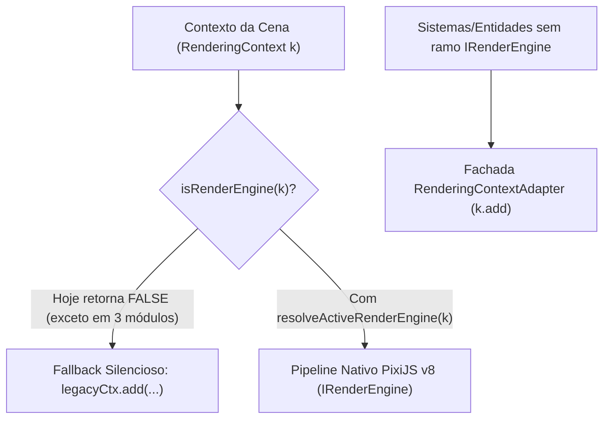

# Plano de Conclusão da Migração Kaboom.js → PixiJS v8 (`IRenderEngine`)

> [!IMPORTANT]
> **Descoberta Arquitetural Crítica (Causa-Raiz do Fallback Silencioso em Runtime):**
> Em [`main.ts`](file:///c:/Users/armin/Documents/projetos/micro-splash/src/main.ts#L42-L45), a aplicação instancia `renderingContext = createRenderingContext(renderEngine, sceneManager)` e o repassa para todas as cenas (`gameScene`, `menuScene`, `splashScene`, etc.).
> Contudo, o predicado [`isRenderEngine(target)`](file:///c:/Users/armin/Documents/projetos/micro-splash/src/engine/contracts/INTERFACE_CONTRACTS.ts#L237-L246) verifica apenas se `"createGraphics" in target && "getTicker" in target && "getDimensions" in target` existem na raiz do objeto. Como [`RenderingContext`](file:///c:/Users/armin/Documents/projetos/micro-splash/src/engine/adapters/RenderingContextAdapter.ts#L284-L286) encapsula o motor na propriedade `.renderEngine`, a chamada `isRenderEngine(k)` retorna **`false`** em tempo de execução!
>
> **Consequência direta na imagem reportada:**
>
> - Apenas [`benthicFloorSystem.ts`](file:///c:/Users/armin/Documents/projetos/micro-splash/src/systems/benthicFloorSystem.ts#L233-L240), [`canyonObstacles.ts`](file:///c:/Users/armin/Documents/projetos/micro-splash/src/systems/canyon/canyonObstacles.ts#L76-L92) e [`playerNetOverlay.ts`](file:///c:/Users/armin/Documents/projetos/micro-splash/src/entities/player/playerNetOverlay.ts#L594-L616) extraem `engineCandidate.renderEngine`.
> - Todos os outros **15 sistemas visuais** (incluindo [`iceSurface.ts`](file:///c:/Users/armin/Documents/projetos/micro-splash/src/systems/iceSurface.ts#L126), [`parallaxSkySystem.ts`](file:///c:/Users/armin/Documents/projetos/micro-splash/src/systems/parallaxSkySystem.ts#L291), [`waterSurfaceSystem.ts`](file:///c:/Users/armin/Documents/projetos/micro-splash/src/systems/waterSurfaceSystem.ts#L172), [`oceanFloorSystem.ts`](file:///c:/Users/armin/Documents/projetos/micro-splash/src/systems/oceanFloorSystem.ts#L296), [`lightRaysSystem.ts`](file:///c:/Users/armin/Documents/projetos/micro-splash/src/systems/lightRaysSystem.ts#L98), [`auroraSystem.ts`](file:///c:/Users/armin/Documents/projetos/micro-splash/src/systems/auroraSystem.ts#L96), [`abyssalFogSystem.ts`](file:///c:/Users/armin/Documents/projetos/micro-splash/src/systems/abyssalFogSystem.ts#L86), [`coastalSurfSystem.ts`](file:///c:/Users/armin/Documents/projetos/micro-splash/src/systems/coastalSurfSystem.ts#L98), [`marineSnowSystem.ts`](file:///c:/Users/armin/Documents/projetos/micro-splash/src/systems/marineSnowSystem.ts#L188), [`weatherSystem.ts`](file:///c:/Users/armin/Documents/projetos/micro-splash/src/systems/weatherSystem.ts#L196), [`dynamicShadowSystem.ts`](file:///c:/Users/armin/Documents/projetos/micro-splash/src/systems/dynamicShadowSystem.ts#L204), [`bioluminescenceSystem.ts`](file:///c:/Users/armin/Documents/projetos/micro-splash/src/systems/bioluminescenceSystem.ts#L234), [`biomeVignetteSystem.ts`](file:///c:/Users/armin/Documents/projetos/micro-splash/src/systems/biomeVignetteSystem.ts#L123), [`depthDarknessSystem.ts`](file:///c:/Users/armin/Documents/projetos/micro-splash/src/systems/depthDarknessSystem.ts#L164) e [`particlePool.ts`](file:///c:/Users/armin/Documents/projetos/micro-splash/src/systems/particlePool.ts#L334)) e **18 módulos de UI** caem silenciosamente no bloco `// Modo Legacy Kaboom Bridge` (`legacyCtx`) durante o jogo!
> - É exatamente por isso que, na captura de tela, o paredão de gelo polar à esquerda foi renderizado como um retângulo azul chapado (`legacyCtx.rect` com cor `[150, 195, 235]`) e as nuvens como pílulas brancas simples, em vez de usarem as texturas 16-bit (`create16BitIceTextures`) e o céu volumétrico do pipeline PixiJS v8!

---

## Diagnóstico Completo dos Vestígios no Repositório

A auditoria em `src/engine/`, `src/scenes/`, `src/systems/`, `src/entities/` e `src/ui/` identificou **4 categorias** de pontos pendentes para concluir 100% da migração:

### Categoria 1 — Sistemas e Módulos de UI com Pipeline PixiJS v8 Já Implementado, mas Inativo em Runtime via `RenderingContext` (33 arquivos)

Estes módulos já possuem todo o código nativo PixiJS v8 (`createGraphics`, `createSprite`, `createText`, `getWorldContainer`, `getScreenContainer`), mas testam `if (isRenderEngine(engineOrContext))` diretamente sobre `k` (`RenderingContext`) sem desempacotar `k.renderEngine`:

- **Sistemas (`src/systems/`):**
  - [`abyssalFogSystem.ts`](file:///c:/Users/armin/Documents/projetos/micro-splash/src/systems/abyssalFogSystem.ts#L86)
  - [`auroraSystem.ts`](file:///c:/Users/armin/Documents/projetos/micro-splash/src/systems/auroraSystem.ts#L96)
  - [`bioluminescenceSystem.ts`](file:///c:/Users/armin/Documents/projetos/micro-splash/src/systems/bioluminescenceSystem.ts#L234)
  - [`biomeVignetteSystem.ts`](file:///c:/Users/armin/Documents/projetos/micro-splash/src/systems/biomeVignetteSystem.ts#L123)
  - [`coastalSurfSystem.ts`](file:///c:/Users/armin/Documents/projetos/micro-splash/src/systems/coastalSurfSystem.ts#L98)
  - [`depthDarknessSystem.ts`](file:///c:/Users/armin/Documents/projetos/micro-splash/src/systems/depthDarknessSystem.ts#L164)
  - [`dynamicShadowSystem.ts`](file:///c:/Users/armin/Documents/projetos/micro-splash/src/systems/dynamicShadowSystem.ts#L204)
  - [`iceSurface.ts`](file:///c:/Users/armin/Documents/projetos/micro-splash/src/systems/iceSurface.ts#L126)
  - [`letterboxSystem.ts`](file:///c:/Users/armin/Documents/projetos/micro-splash/src/systems/letterboxSystem.ts#L50)
  - [`lightRaysSystem.ts`](file:///c:/Users/armin/Documents/projetos/micro-splash/src/systems/lightRaysSystem.ts#L98)
  - [`marineSnowSystem.ts`](file:///c:/Users/armin/Documents/projetos/micro-splash/src/systems/marineSnowSystem.ts#L188)
  - [`oceanFloorSystem.ts`](file:///c:/Users/armin/Documents/projetos/micro-splash/src/systems/oceanFloorSystem.ts#L296)
  - [`parallaxSkySystem.ts`](file:///c:/Users/armin/Documents/projetos/micro-splash/src/systems/parallaxSkySystem.ts#L291)
  - [`particlePool.ts`](file:///c:/Users/armin/Documents/projetos/micro-splash/src/systems/particlePool.ts#L334)
  - [`sereneMigrationInsights.ts`](file:///c:/Users/armin/Documents/projetos/micro-splash/src/systems/sereneMigrationInsights.ts#L274)
  - [`shipNoiseSystem.ts`](file:///c:/Users/armin/Documents/projetos/micro-splash/src/systems/shipNoiseSystem.ts#L89)
  - [`waterSurfaceSystem.ts`](file:///c:/Users/armin/Documents/projetos/micro-splash/src/systems/waterSurfaceSystem.ts#L172)
  - [`weatherSystem.ts`](file:///c:/Users/armin/Documents/projetos/micro-splash/src/systems/weatherSystem.ts#L196)
- **Interface de Usuário (`src/ui/`):**
  - [`animationUtils.ts`](file:///c:/Users/armin/Documents/projetos/micro-splash/src/ui/animationUtils.ts#L97), [`debugDistance.ts`](file:///c:/Users/armin/Documents/projetos/micro-splash/src/ui/debugDistance.ts#L118), [`factPopup.ts`](file:///c:/Users/armin/Documents/projetos/micro-splash/src/ui/factPopup.ts#L56), [`hudSystem.ts`](file:///c:/Users/armin/Documents/projetos/micro-splash/src/ui/hudSystem.ts#L145), [`initialsInputModal.ts`](file:///c:/Users/armin/Documents/projetos/micro-splash/src/ui/initialsInputModal.ts#L51), [`keyBadge.ts`](file:///c:/Users/armin/Documents/projetos/micro-splash/src/ui/keyBadge.ts#L62), [`keyboardNav.ts`](file:///c:/Users/armin/Documents/projetos/micro-splash/src/ui/keyboardNav.ts#L131), [`onboardingModal.ts`](file:///c:/Users/armin/Documents/projetos/micro-splash/src/ui/onboardingModal.ts#L144), [`pwaInstallModal.ts`](file:///c:/Users/armin/Documents/projetos/micro-splash/src/ui/pwaInstallModal.ts#L53), [`quizModal.ts`](file:///c:/Users/armin/Documents/projetos/micro-splash/src/ui/quizModal.ts#L147), [`shareModal.ts`](file:///c:/Users/armin/Documents/projetos/micro-splash/src/ui/shareModal.ts#L54), [`statsModal.ts`](file:///c:/Users/armin/Documents/projetos/micro-splash/src/ui/statsModal.ts#L114), [`textUtils.ts`](file:///c:/Users/armin/Documents/projetos/micro-splash/src/ui/textUtils.ts#L104), [`touchControls.ts`](file:///c:/Users/armin/Documents/projetos/micro-splash/src/ui/touchControls.ts#L141)
  - Componentes em `src/ui/shared/`: [`cardButton.ts`](file:///c:/Users/armin/Documents/projetos/micro-splash/src/ui/shared/cardButton.ts#L126), [`modalShell.ts`](file:///c:/Users/armin/Documents/projetos/micro-splash/src/ui/shared/modalShell.ts#L102), [`motion.ts`](file:///c:/Users/armin/Documents/projetos/micro-splash/src/ui/shared/motion.ts#L103), [`scoreCounter.ts`](file:///c:/Users/armin/Documents/projetos/micro-splash/src/ui/shared/scoreCounter.ts#L103), [`tabBar.ts`](file:///c:/Users/armin/Documents/projetos/micro-splash/src/ui/shared/tabBar.ts#L88)

### Categoria 2 — Módulos que Ainda Usam Exclusivamente a Fachada `k.add([...])` Sem Ramo `IRenderEngine`

Estes módulos dependem da tradução em tempo de execução feita pelo [`RenderingContextAdapter.ts`](file:///c:/Users/armin/Documents/projetos/micro-splash/src/engine/adapters/RenderingContextAdapter.ts):

- **Cena Principal (`src/scenes/`):**
  - [`gameScene.ts`](file:///c:/Users/armin/Documents/projetos/micro-splash/src/scenes/gameScene.ts#L327-L438): `fadeOverlay`, `oceanFloor`, `skyBand`, `timerUI` e rótulos de modo (`Migração Serena`, `Desafio Semanal`).
- **Sistemas Ambientais e de Jogo (`src/systems/`):**
  - [`backgroundFauna.ts`](file:///c:/Users/armin/Documents/projetos/micro-splash/src/systems/backgroundFauna.ts)
  - [`breachSystem.ts`](file:///c:/Users/armin/Documents/projetos/micro-splash/src/systems/breachSystem.ts)
  - [`canyonGeometry.ts`](file:///c:/Users/armin/Documents/projetos/micro-splash/src/systems/canyon/canyonGeometry.ts)
  - [`dolphinDraftingSystem.ts`](file:///c:/Users/armin/Documents/projetos/micro-splash/src/systems/dolphinDraftingSystem.ts)
  - [`oceanCurrentsSystem.ts`](file:///c:/Users/armin/Documents/projetos/micro-splash/src/systems/oceanCurrentsSystem.ts)
  - [`oilSpillSystem.ts`](file:///c:/Users/armin/Documents/projetos/micro-splash/src/systems/oilSpillSystem.ts)
  - [`penguinFlockSystem.ts`](file:///c:/Users/armin/Documents/projetos/micro-splash/src/systems/penguinFlockSystem.ts)
  - [`presentationMode.ts`](file:///c:/Users/armin/Documents/projetos/micro-splash/src/systems/presentationMode.ts)
  - [`upwellingSystem.ts`](file:///c:/Users/armin/Documents/projetos/micro-splash/src/systems/upwellingSystem.ts)
- **Entidades (`src/entities/`):**
  - [`boat.ts`](file:///c:/Users/armin/Documents/projetos/micro-splash/src/entities/boat.ts), [`bubbleVent.ts`](file:///c:/Users/armin/Documents/projetos/micro-splash/src/entities/bubbleVent.ts), [`krill.ts`](file:///c:/Users/armin/Documents/projetos/micro-splash/src/entities/krill.ts), [`net.ts`](file:///c:/Users/armin/Documents/projetos/micro-splash/src/entities/net.ts), [`trash.ts`](file:///c:/Users/armin/Documents/projetos/micro-splash/src/entities/trash.ts)
  - Submódulos: [`companionSenses.ts`](file:///c:/Users/armin/Documents/projetos/micro-splash/src/entities/companion/companionSenses.ts), [`companionStates.ts`](file:///c:/Users/armin/Documents/projetos/micro-splash/src/entities/companion/companionStates.ts), [`playerCaustics.ts`](file:///c:/Users/armin/Documents/projetos/micro-splash/src/entities/player/playerCaustics.ts), [`playerParticles.ts`](file:///c:/Users/armin/Documents/projetos/micro-splash/src/entities/player/playerParticles.ts), [`playerSonar.ts`](file:///c:/Users/armin/Documents/projetos/micro-splash/src/entities/player/playerSonar.ts)
- **Telas e Abas de UI (`src/ui/`):**
  - [`challengeEndScreen.ts`](file:///c:/Users/armin/Documents/projetos/micro-splash/src/ui/challengeEndScreen.ts), [`victoryScreen.ts`](file:///c:/Users/armin/Documents/projetos/micro-splash/src/ui/victoryScreen.ts), abas em `src/ui/codex/*` e `src/ui/options/*`.

### Categoria 3 — Blocos `legacyCtx` ("Modo Legacy Kaboom Bridge") e Tipagens Residuais

- 16 arquivos em `src/systems/` (mais [`letterboxSystem.ts`](file:///c:/Users/armin/Documents/projetos/micro-splash/src/systems/letterboxSystem.ts#L127) que ainda contém um `as any` na linha 127) mantêm centenas de linhas de código duplicado no bloco `else { const legacyCtx = ... }` exclusivamente para suportar mocks legados em testes unitários que simulam a API Kaboom (`{ add, rect, pos, color, ... }`) sem fornecer um `IRenderEngine` inicializado.
- [`gameScene.ts`](file:///c:/Users/armin/Documents/projetos/micro-splash/src/scenes/gameScene.ts#L71) e [`menuScene.ts`](file:///c:/Users/armin/Documents/projetos/micro-splash/src/scenes/menuScene.ts#L15) ainda possuem `// eslint-disable-next-line @typescript-eslint/no-unsafe-function-type` na assinatura legada `scene(id: string, action: Function): unknown`.

---

## Plano de Implementação em Fases (Seguindo `ai.rules` e `SKILLS.md`)

### Fase 1: Resolução Canônica de `IRenderEngine` e Ativação do Pipeline PixiJS v8 Nativo (Prioridade Máxima — Impacto Visual Imediato)

**Objetivo:** Garantir que todos os sistemas e componentes de UI que recebem `k` (`RenderingContext`) ou `IRenderEngine` resolvam a instância ativa e inicializada do `IRenderEngine` de forma determinística, sem quebrar testes unitários que passam mocks legados não inicializados.

1. **Criar `resolveInitializedRenderEngine(engineOrContext: unknown): IRenderEngine | null` em [`INTERFACE_CONTRACTS.ts`](file:///c:/Users/armin/Documents/projetos/micro-splash/src/engine/contracts/INTERFACE_CONTRACTS.ts):**
   - Se `isRenderEngine(engineOrContext)` for verdadeiro e `isInitialized !== false`, retorna `engineOrContext`.
   - Se `engineOrContext` for um objeto contendo `.renderEngine` onde `isRenderEngine(engineOrContext.renderEngine)` é verdadeiro **e** `engineOrContext.renderEngine.isInitialized === true`, retorna `engineOrContext.renderEngine`.
   - Caso contrário (ex.: testes unitários que instanciam `createRenderingContext(new RenderEngineAdapter(), ...)` sem chamar `await renderEngine.init()`, ou mocks puros `{ add, rect, pos }`), retorna `null` para preservar a compatibilidade com os testes existentes até que sejam migrados na Fase 4.
2. **Sincronizar Colisões de Superfície e Gelo no Pipeline PixiJS v8:**
   - Verificar em [`waterSurfaceSystem.ts`](file:///c:/Users/armin/Documents/projetos/micro-splash/src/systems/waterSurfaceSystem.ts) e [`iceSurface.ts`](file:///c:/Users/armin/Documents/projetos/micro-splash/src/systems/iceSurface.ts) que, quando executados no ramo PixiJS v8 via `RenderingContext`, os objetos/tags consultados por `k.get(TAGS.SURFACE)` ou `getSpatialGrid()` estejam devidamente registrados e que seus listeners de ticker (`engine.getTicker().add(...)`) sejam limpos no `onSceneLeave` da cena para evitar vazamento entre cenas.
3. **Atualizar os 33 módulos da Categoria 1 (`src/systems/*` e `src/ui/*`):**
   - Substituir `if (isRenderEngine(engineOrContext))` por `const resolvedRenderEngine = resolveInitializedRenderEngine(engineOrContext); if (resolvedRenderEngine)`.
   - Corrigir o `as any` residual em [`letterboxSystem.ts`](file:///c:/Users/armin/Documents/projetos/micro-splash/src/systems/letterboxSystem.ts#L127) e os `Function` em [`gameScene.ts`](file:///c:/Users/armin/Documents/projetos/micro-splash/src/scenes/gameScene.ts#L71-L72) e [`menuScene.ts`](file:///c:/Users/armin/Documents/projetos/micro-splash/src/scenes/menuScene.ts#L15-L16).

### Fase 2: Migração dos Elementos Visuais de `gameScene.ts` e Sistemas Ambientais Remanescentes

**Objetivo:** Converter os elementos visuais que ainda dependem exclusivamente de `k.add([k.rect(...), ...])` para nós nativos (`IGraphicsNode`, `ISpriteNode`, `ITextNode`) acoplados a `worldContainer` e `screenContainer`.

1. **Elementos Diretos de [`gameScene.ts`](file:///c:/Users/armin/Documents/projetos/micro-splash/src/scenes/gameScene.ts#L327-L438):**
   - Migrar `fadeOverlay`, `oceanFloor`, `skyBand`, `timerUI` e badges de modo (`Migração Serena`, `Desafio Semanal`) para usar `resolvedRenderEngine.createGraphics()` / `createText()` anexados a `getScreenContainer()` (elementos fixos) e `getWorldContainer()` (`oceanFloor`, `skyBand`).
2. **Sistemas Ambientais de `src/systems/` (Categoria 2):**
   - Adicionar suporte nativo `IRenderEngine` (usando `resolveInitializedRenderEngine`) em:
     - [`backgroundFauna.ts`](file:///c:/Users/armin/Documents/projetos/micro-splash/src/systems/backgroundFauna.ts)
     - [`penguinFlockSystem.ts`](file:///c:/Users/armin/Documents/projetos/micro-splash/src/systems/penguinFlockSystem.ts)
     - [`dolphinDraftingSystem.ts`](file:///c:/Users/armin/Documents/projetos/micro-splash/src/systems/dolphinDraftingSystem.ts)
     - [`oceanCurrentsSystem.ts`](file:///c:/Users/armin/Documents/projetos/micro-splash/src/systems/oceanCurrentsSystem.ts)
     - [`upwellingSystem.ts`](file:///c:/Users/armin/Documents/projetos/micro-splash/src/systems/upwellingSystem.ts)
     - [`oilSpillSystem.ts`](file:///c:/Users/armin/Documents/projetos/micro-splash/src/systems/oilSpillSystem.ts)
     - [`canyonGeometry.ts`](file:///c:/Users/armin/Documents/projetos/micro-splash/src/systems/canyon/canyonGeometry.ts)
     - [`breachSystem.ts`](file:///c:/Users/armin/Documents/projetos/micro-splash/src/systems/breachSystem.ts)
     - [`presentationMode.ts`](file:///c:/Users/armin/Documents/projetos/micro-splash/src/systems/presentationMode.ts)

### Fase 3: Migração de Entidades de Jogo e Submódulos do Jogador (`src/entities/`)

**Objetivo:** Desacoplar as entidades interativas e efeitos locais da baleia da fachada `k.add([...])`, mantendo o registro determinístico no `SpatialHashGrid` e no `RenderingContext` para colisões:

1. Efeitos visuais do jogador e companheira: [`playerCaustics.ts`](file:///c:/Users/armin/Documents/projetos/micro-splash/src/entities/player/playerCaustics.ts), [`playerParticles.ts`](file:///c:/Users/armin/Documents/projetos/micro-splash/src/entities/player/playerParticles.ts), [`playerSonar.ts`](file:///c:/Users/armin/Documents/projetos/micro-splash/src/entities/player/playerSonar.ts), [`companionSenses.ts`](file:///c:/Users/armin/Documents/projetos/micro-splash/src/entities/companion/companionSenses.ts), [`companionStates.ts`](file:///c:/Users/armin/Documents/projetos/micro-splash/src/entities/companion/companionStates.ts).
2. Entidades do mundo: [`boat.ts`](file:///c:/Users/armin/Documents/projetos/micro-splash/src/entities/boat.ts), [`bubbleVent.ts`](file:///c:/Users/armin/Documents/projetos/micro-splash/src/entities/bubbleVent.ts), [`krill.ts`](file:///c:/Users/armin/Documents/projetos/micro-splash/src/entities/krill.ts), [`net.ts`](file:///c:/Users/armin/Documents/projetos/micro-splash/src/entities/net.ts), [`trash.ts`](file:///c:/Users/armin/Documents/projetos/micro-splash/src/entities/trash.ts).

### Fase 4: Migração de Testes Unitários Legados, Descomissionamento de `legacyCtx` e Modularização (< 300 linhas)

**Objetivo:** Eliminar o código morto dos blocos `// Modo Legacy Kaboom Bridge` e reduzir o tamanho dos arquivos acima de 300 linhas (conforme Regra 8 do `ai.rules`).

1. Criar um helper de teste padronizado `createMockRenderEngine(): IRenderEngine` para os testes em `src/systems/__tests__/` e `src/ui/__tests__/` que ainda injetam mocks no formato Kaboom (`{ add, rect, pos, color }`).
2. Remover os blocos `else { const legacyCtx = ... }` dos 16 sistemas em `src/systems/` e dos componentes em `src/ui/`.
3. Decompor módulos que excedem 300 linhas (como [`benthicFloorSystem.ts`](file:///c:/Users/armin/Documents/projetos/micro-splash/src/systems/benthicFloorSystem.ts), [`parallaxSkySystem.ts`](file:///c:/Users/armin/Documents/projetos/micro-splash/src/systems/parallaxSkySystem.ts), [`iceSurface.ts`](file:///c:/Users/armin/Documents/projetos/micro-splash/src/systems/iceSurface.ts) e [`RenderingContextAdapter.ts`](file:///c:/Users/armin/Documents/projetos/micro-splash/src/engine/adapters/RenderingContextAdapter.ts)) em submódulos coesos de responsabilidade única.

---

## Critérios de Verificação (Gate de Qualidade)

Ao final de cada fase, executar obrigatoriamente:

- `npx tsc --noEmit` (0 erros de compilação)
- `npx eslint src/` (0 erros e 0 warnings, sem `@typescript-eslint/no-explicit-any` ou `no-unsafe-function-type`)
- `npm test` (100% das suítes Vitest passando)
- `npm run validate:data` (validação de integridade de dados e schemas)
